# LAPORAN PENGUJIAN MOBILE — KKMP KERTEN
## Metode Maestro MCP Server — dengan Screenshot Bukti Asli

**Mata kuliah:** Mobile Testing (UTS) · **Tahun ajaran:** 2026/2027  
**Aplikasi:** KKMP Kerten, Flutter Android v1.5.4+8  
**Package:** `com.fauzibondanp.shopmart`  
**Perangkat:** Xiaomi Android fisik (pengujian lokal, bukan emulator/Cloud)  
**Repository:** `fauzibp-dev/coba_flutter`  
**Tanggal sumber bukti dan audit:** 8–11 November 2026  
**Nama / NIM / kelas / peran:** *diisi pemilik laporan sebelum pengumpulan*  
**Catatan sumber:** Gambar pada dokumen ini adalah PNG **asli** yang sudah disimpan di root repository dari proses UAT/otomatisasi MCP sebelumnya, bukan gambar Maestro Studio. Tanggal pada setiap gambar mungkin lebih awal daripada tanggal penyusunan laporan. Laporan ini tidak mengklaim tes ulang terbaru.

---

## 1. Ringkasan eksekutif dan pembatasan interpretasi

Laporan ini menjelaskan evaluasi aplikasi KKMP Kerten dengan Maestro MCP Server pada HP Xiaomi fisik, disertai dokumen UAT dan artefak yang tercatat di repository. Semua hasil harus dipahami sesuai lingkup tes yang benar-benar dilakukan; tidak menyamakan hasil UAT dengan jumlah flow YAML yang berhasil.

| Status kasus dalam audit UAT 136 kasus | Jumlah |
|---|---:|
| PASS (sebagian memiliki kualifikasi PASS parsial) | 14 |
| FAIL | 1 |
| BLOCKED | 3 |
| NOT RUN | 118 |
| **Total** | **136** |

**Perlu diperhatikan:** status `PASS*` pada beberapa kasus hanya membuktikan subset kriteria, bukan persetujuan UAT penuh. Pengujian final create order, mutasi stok dari order, perubahan role, penghapusan produk permanen, dan beberapa pengujian keamanan di luar cakupan bukti yang tersedia.

**Beda dengan Maestro Studio:** screenshot dan angka **12/12 PASS Studio** berasal dari metode yang berbeda. Jangan salin kesimpulan itu ke laporan MCP.

## 2. Dasar pengujian dan tata cara

- **Tujuan:** mengukur keteraksesan halaman, alur customer, pencarian, keranjang, validasi, serta CRUD produk dalam ruang lingkup yang diizinkan.
- **Platform:** Flutter Android dan Supabase, diuji di Xiaomi fisik yang terhubung ADB.
- **Teknik:** instruksi pengujian Maestro/MCP, assertion, observasi UI aktual, screenshot dan trace yang direkam.
- **Dokumen sumber:** [UTS_UAT_REPORT.md](UTS_UAT_REPORT.md), [ringkasan eksekusi](results/uat_execution_summary_20261110.md), [defect log](results/uat_bugs_20261110.md), serta [log diagnosis alamat dan CRUD](results/uat036_diagnosis_and_admin_crud_20261108-1355.log).
- **Struktur flow:** [folder .maestro](../.maestro/) berisi berbagai flow termasuk startup, navigasi, cart, transaksi/checkout guard, validasi dan pengujian admin. Tidak setiap file berhasil dieksekusi sepenuhnya; lihat hasil per-kasus di bawah.
- **Sifat bukti:** screenshot tidak berdiri sendiri untuk membuktikan semua nilai di database; dibaca bersama log, langkah, dan hasil aktual.

## 3. Skenario inti UAT beserta screenshot

### UAT-013 — Katalog Beranda

**Tujuan:** Memastikan pelanggan dapat melihat katalog produk aktif.  
**Peran:** Guest / Customer  
**Prasyarat:** APK terpasang dan katalog memiliki produk aktif.  
**Langkah:** Buka aplikasi → Beranda → periksa konten dan item.  
**Kriteria penerimaan:** Nama serta produk aktif muncul pada katalog.  
**Hasil aktual:** Beranda KKMP Kerten dan daftar produk dapat ditampilkan.  
**Status:** **PASS**

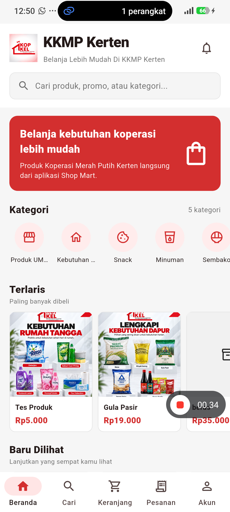

*Gambar: Tampilan Beranda KKMP Kerten. File asli: [startup-home.png](../startup-home.png).*

### UAT-015 — Navigasi kategori produk

**Tujuan:** Memastikan jalur kategori dapat digunakan.  
**Peran:** Guest / Customer  
**Prasyarat:** Kategori Sembako tersedia.  
**Langkah:** Buka katalog/kategori → pilih Sembako.  
**Kriteria penerimaan:** Navigasi kategori berhasil, menampilkan produk relevan.  
**Hasil aktual:** Kategori Sembako terbuka dan produk terkait terlihat.  
**Status:** **PASS**

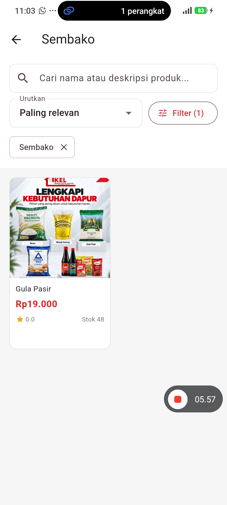

*Gambar: Navigasi kategori Sembako. File asli: [uat-u15-category-sembako.png](../uat-u15-category-sembako.png).*

### UAT-019 — Pencarian produk

**Tujuan:** Memeriksa pencarian nama produk.  
**Peran:** Guest / Customer  
**Prasyarat:** Produk beras tersedia di katalog.  
**Langkah:** Buka Pencarian → masukkan `beras` → jalankan pencarian.  
**Kriteria penerimaan:** Hasil pencarian relevan ditampilkan.  
**Hasil aktual:** Kata kunci beras menghasilkan produk terkait pada aplikasi.  
**Status:** **PASS**

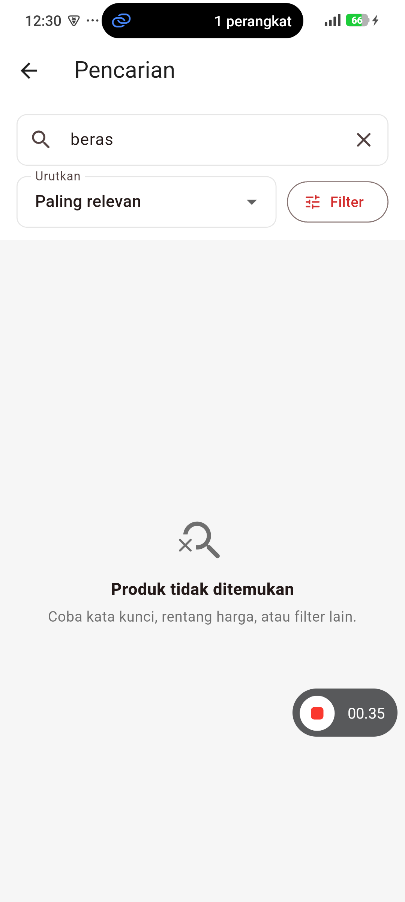

*Gambar: Hasil pencarian kata kunci beras. File asli: [search-results-beras.png](../search-results-beras.png).*

### UAT-021 — Validasi pencarian tanpa hasil

**Tujuan:** Menguji kondisi ketika kata kunci tidak cocok dengan produk.  
**Peran:** Guest / Customer  
**Prasyarat:** Halaman pencarian dapat dibuka.  
**Langkah:** Masukkan `zzzuatnotfound` → periksa kondisi hasil.  
**Kriteria penerimaan:** Empty state informatif dan tidak menampilkan produk yang tidak sesuai.  
**Hasil aktual:** Pesan `Produk tidak ditemukan` dan petunjuk pencarian lain muncul.  
**Status:** **PASS**

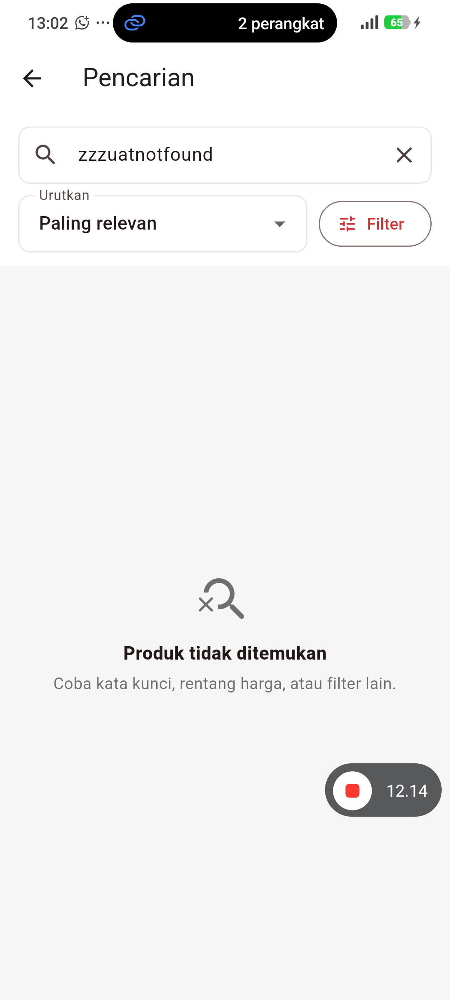

*Gambar: Validasi pencarian dengan kata kunci tidak ditemukan. File asli: [uat-validation-empty-search.png](../uat-validation-empty-search.png).*

### UAT-023 — Detail produk

**Tujuan:** Menguji bahwa halaman detail produk dapat dibuka.  
**Peran:** Guest / Customer  
**Prasyarat:** Produk aktif tersedia.  
**Langkah:** Temukan produk → ketuk produk → lihat halaman detail.  
**Kriteria penerimaan:** Data nama, harga, deskripsi, ketersediaan dan gambar konsisten dengan data produk.  
**Hasil aktual:** Halaman detail terbuka, tetapi perbandingan seluruh field terhadap dataset belum dituntaskan.  
**Status:** **PASS PARSIAL — bukan sign-off penuh**

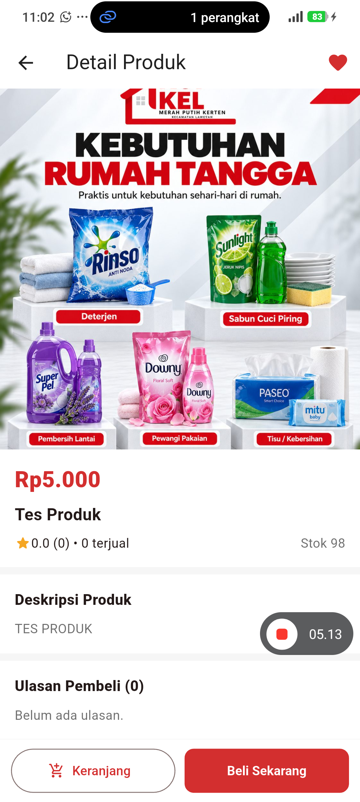

*Gambar: Pembukaan detail produk. File asli: [uat-u23-product-detail.png](../uat-u23-product-detail.png).*

### UAT-029 — Tambah kuantitas produk di keranjang

**Tujuan:** Menguji tombol tambah kuantitas dan dampaknya terhadap subtotal.  
**Peran:** Customer  
**Prasyarat:** Sesi customer aktif dan stok produk cukup.  
**Langkah:** Masukkan beras ke keranjang → tambah kuantitas → amati subtotal.  
**Kriteria penerimaan:** Kuantitas dan subtotal berubah secara konsisten sesuai harga.  
**Hasil aktual:** Bukti menunjukkan 5 × Rp35.000 = Rp175.000 dan 8 × Rp35.000 = Rp280.000; assertion subtotal numerik secara otomatis tidak tercatat.  
**Status:** **PASS PARSIAL — bukti angka tersedia, assertion numerik belum**

*Gambar: Percobaan penambahan kuantitas keranjang. File asli: [uat-cart-plus-attempt.png](../uat-cart-plus-attempt.png).*

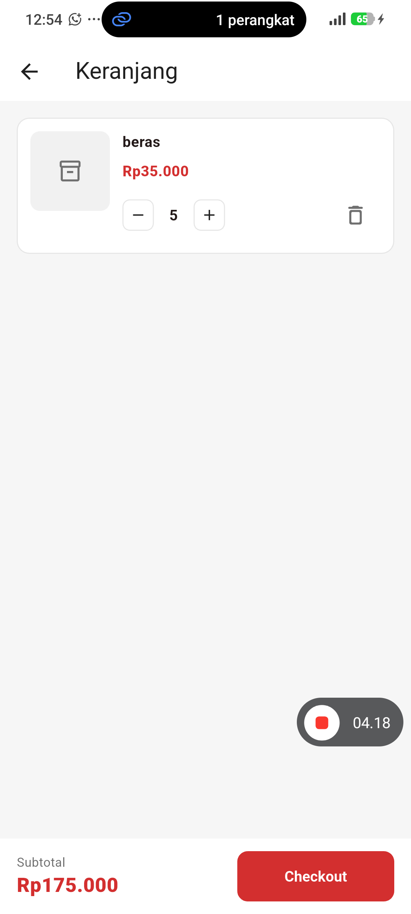

*Gambar: Kuantitas lanjutan dan subtotal keranjang. File asli: [uat-cart-plus-second-attempt.png](../uat-cart-plus-second-attempt.png).*

### REG-001 — Navigasi sampai checkout

**Tujuan:** Memastikan tampilan checkout tidak kosong dan section penting dapat dilihat.  
**Peran:** Customer  
**Prasyarat:** Cart berisi produk.  
**Langkah:** Buka cart → lanjut ke checkout → periksa panel fulfillment/pembayaran.  
**Kriteria penerimaan:** Halaman checkout menampilkan section penting tanpa white screen.  
**Hasil aktual:** Bagian utama checkout terlihat, tetapi submit order final dan verifikasi total lengkap tidak dilakukan.  
**Status:** **PASS PARSIAL — bukan bukti pesanan berhasil dibuat**

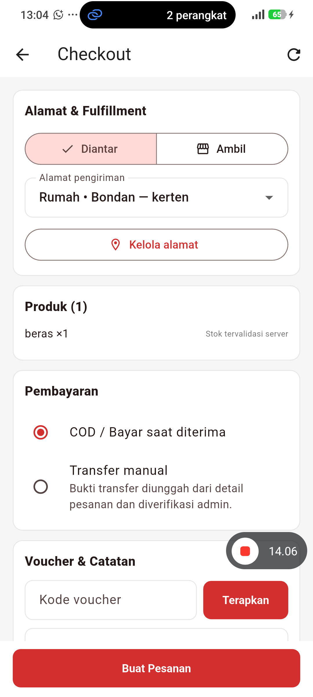

*Gambar: Tampilan checkout hasil navigasi dari cart. File asli: [uat-transaction-checkout.png](../uat-transaction-checkout.png).*

### UAT-036 — Pembuatan alamat tersimpan

**Tujuan:** Menguji apakah alamat baru tersimpan dan muncul ketika daftar dibuka lagi.  
**Peran:** Customer  
**Prasyarat:** Login customer; form alamat dapat diakses.  
**Langkah:** Buka Akun → Alamat Tersimpan → Tambah → isi field wajib → Simpan Alamat → buka daftar lagi.  
**Kriteria penerimaan:** Alamat baru muncul dan bisa dipilih.  
**Hasil aktual:** Isian alamat terlihat sebelum save, tetapi alamat uji tidak ditemukan dalam daftar setelah penyimpanan.  
**Status:** **FAIL — DEF-030 masih OPEN**

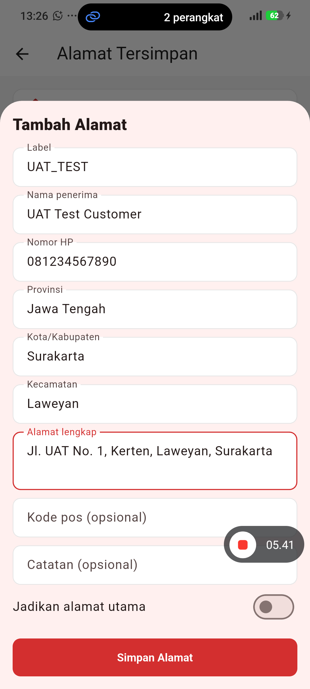

*Gambar: Form alamat UAT_TEST terisi. File asli: [uat-address-form-filled.png](../uat-address-form-filled.png).*

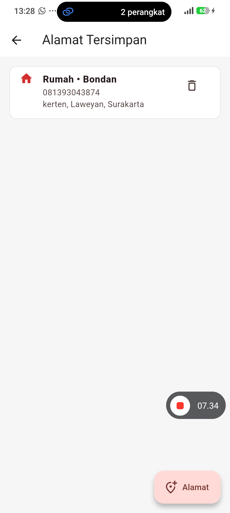

*Gambar: Percobaan menyimpan alamat. File asli: [uat-address-save-attempt.png](../uat-address-save-attempt.png).*

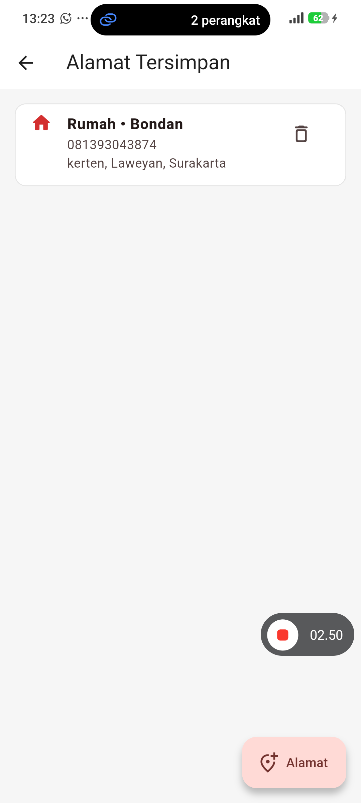

*Gambar: Daftar alamat setelah penyimpanan: entri uji tidak terlihat. File asli: [uat-address-create-failed.png](../uat-address-create-failed.png).*

### UAT-045 — Validasi voucher tidak sah

**Tujuan:** Mengevaluasi feedback untuk kode voucher yang tidak valid.  
**Peran:** Customer  
**Prasyarat:** Checkout terbuka dan voucher dapat dimasukkan.  
**Langkah:** Masukkan `INVALID-UAT` → Terapkan.  
**Kriteria penerimaan:** Voucher ditolak melalui pesan yang aman dan total akhir tidak berubah.  
**Hasil aktual:** Voucher ditolak, namun aplikasi memperlihatkan pesan teknis PostgrestException P0001; total setelah penolakan belum diverifikasi.  
**Status:** **BLOCKED — DEF-032, hasil akhir belum tervalidasi**

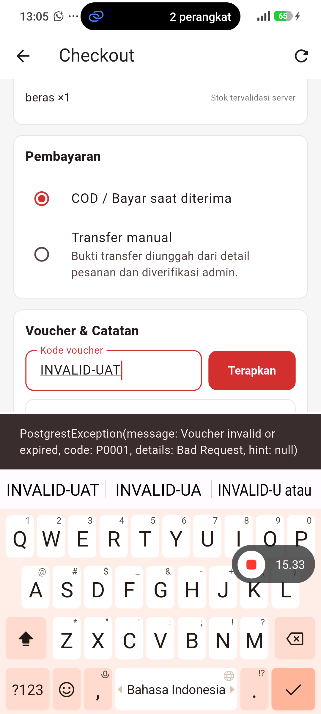

*Gambar: Pesan teknis yang tampil ketika voucher tidak valid. File asli: [uat-invalid-voucher.png](../uat-invalid-voucher.png).*

## 4. Bukti CRUD produk oleh Super Admin (uji MCP terpisah)

**Konteks:** tindakan ini dilakukan pada data produk uji di lingkungan pengujian. Tidak mencakup penghapusan permanen. Temuan dialog Flutter setelah save dicatat terpisah dari hasil mutasi database.

| Operasi | Bukti aktual | Kualifikasi |
|---|---|---|
| CREATE | Produk UAT_TEST_PRODUK_20261108 dibuat, harga Rp10.000 | Berhasil dibuat di UI; dialog sempat menunjukkan assertion Flutter |
| READ | Produk uji terlihat dalam katalog admin | Terlihat |
| UPDATE | Harga produk berubah Rp10.000 → Rp11.000 | Terlihat pada UI/query |
| ARCHIVE | Produk uji diarsipkan | Bukan DELETE permanen |

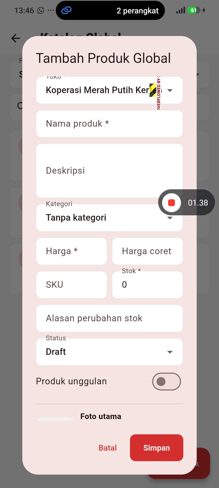

*Gambar: Form pembuatan produk uji Super Admin. File asli: [uat-admin-product-create-form.png](../uat-admin-product-create-form.png).*
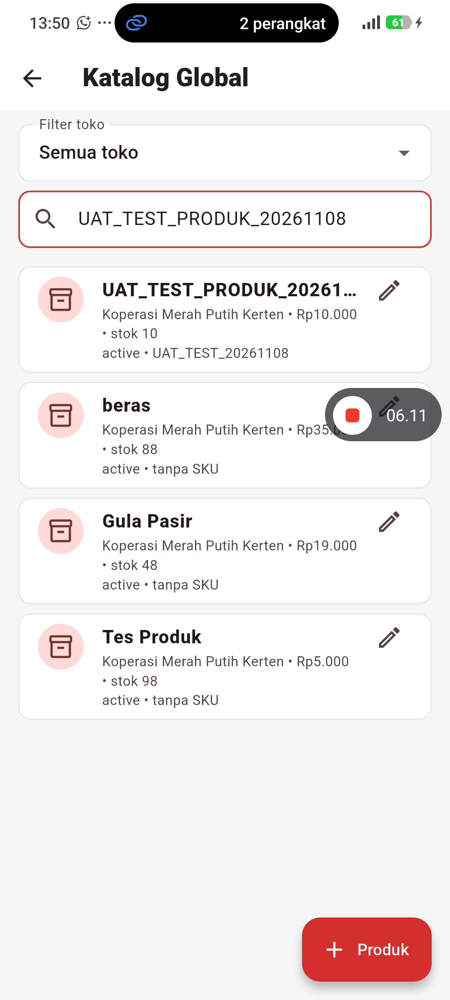

*Gambar: Bukti pembacaan produk uji di katalog admin. File asli: [uat-admin-product-read.png](../uat-admin-product-read.png).*
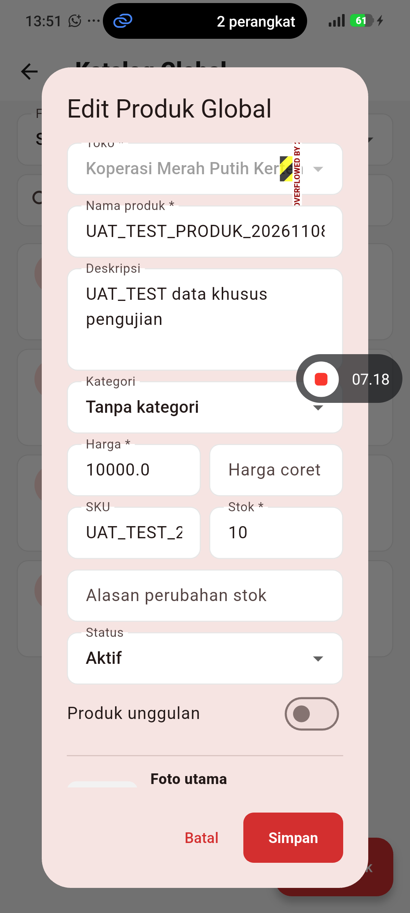

*Gambar: Form pembaruan harga produk uji. File asli: [uat-admin-product-edit-form.png](../uat-admin-product-edit-form.png).*
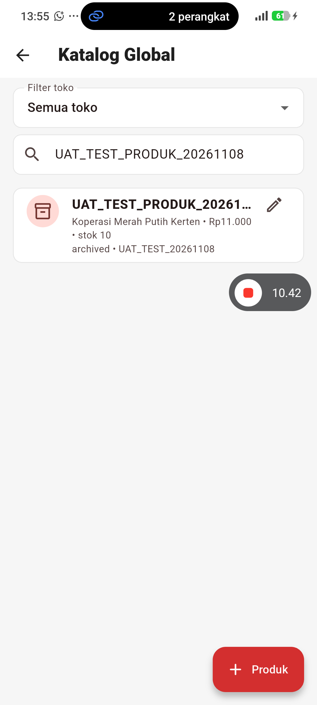

*Gambar: Proses pengarsipan produk uji. File asli: [uat-admin-product-archive-attempt.png](../uat-admin-product-archive-attempt.png).*

## 5. Bantuan customer, notifikasi dan error log

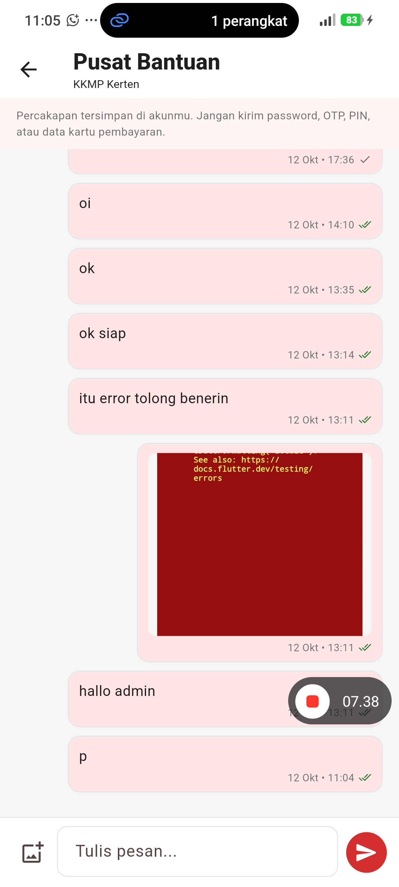

*Gambar: Halaman Pusat Bantuan / customer support dapat dibuka. File asli: [uat-chat-open.png](../uat-chat-open.png).*
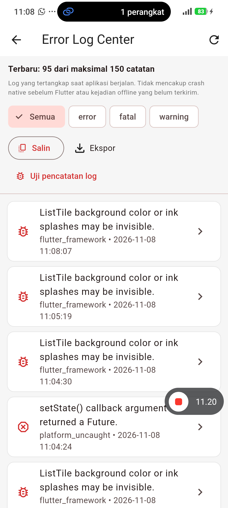

*Gambar: Tampilan Error Log Center. File asli: [uat-reg013-error-log-center.png](../uat-reg013-error-log-center.png).*
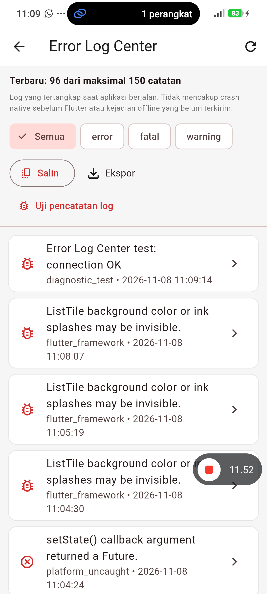

*Gambar: Tampilan hasil observasi Error Log Center. File asli: [uat-reg013-error-log-after-test.png](../uat-reg013-error-log-after-test.png).*

**Batasan:** pembukaan halaman bantuan tidak membuktikan pesan berhasil dikirim. Observasi Error Log Center tidak otomatis berarti seluruh subkriteria regresi telah PASS.

## 6. Daftar temuan bug yang tetap harus dilaporkan

| Kode | Masalah dan bukti | Dampak | Status sumber |
|---|---|---|---|
| DEF-030 / UAT-036 | Alamat UAT_TEST tidak muncul setelah save; bukti pada tiga screenshot alamat di atas | Address book / checkout berbasis alamat | OPEN, UAT FAIL |
| DEF-031 | Assertion Flutter `_dependents.isEmpty` pada alur dialog produk | Pengalaman admin terganggu walaupun data mungkin termutasi | OPEN, observasi |
| DEF-032 / UAT-045 | `PostgrestException P0001` terekspos ketika voucher tidak valid | Pesan error teknis ke customer | OPEN, UAT BLOCKED |
| DEF-033 | RenderFlex `OVERFLOWED BY` pada dialog tambah/edit produk | Layout tidak stabil pada perangkat | OPEN, observasi |

**Tidak menyimpulkan akar masalah tanpa bukti.** Alamat tidak tersimpan dapat melibatkan respons insert, sesi pengguna, RLS, jaringan, atau proses refresh; query anonim tidak cukup untuk memastikan penyebabnya.

## 7. Ringkasan kesesuaian tugas UTS

| Persyaratan | Bukti dalam repository | Status |
|---|---|---|
| Minimal 5 skenario UAT lengkap | Bagian 3 (>= 5 skenario dengan tujuan, peran, prasyarat, langkah, kriteria, actual dan bukti) | Ada |
| Minimal 4 flow YAML Maestro: startup, navigasi, transaksi/CRUD, validasi | Folder `.maestro/` serta bagian 3–4 dan laporan UAT utama | Ada, pelaksanaan tiap flow mengacu hasil nyata |
| Assertion dan screenshot / log | Screenshot asli inline di bagian 3–5; YAML dan log sumber tetap ada di repository | Ada |
| Source Android dan cara menjalankan | [README utama](../README.md) + `lib/` | Ada |
| Laporan PDF/Markdown | Dokumen Markdown ini adalah laporan MCP dengan bukti gambar ter-render di GitHub | Ada |
| Video penjelasan 5–10 menit | Tautan harus diisi mahasiswa | **Belum diverifikasi** |
| Identitas, NIM, pembagian tugas | Masih perlu identitas resmi | **Belum lengkap** |
| Repository dapat dibuka dosen | Repo private; perlu memberi dosen akses | **Belum diverifikasi** |

## 8. Kesimpulan

Dari bukti yang tersimpan, Maestro MCP Server membantu verifikasi jalur katalog, kategori, pencarian, penanganan hasil kosong, keranjang, checkout screen, alamat, dan CRUD produk uji. Sebagian pengujian yang hanya mencakup subset kriteria tetap diberi status PARSIAL. Satu kegagalan alamat dan sejumlah temuan kualitas aplikasi belum diselesaikan oleh bukti ini. Secara keseluruhan, dokumentasi mencatat **14 PASS, 1 FAIL, 3 BLOCKED, 118 NOT RUN** pada matriks 136 kasus UAT, bukan hasil 136 flow Maestro.

**Dokumen ini dilengkapi screenshot yang dirender langsung dari path PNG di repository privat GitHub.** Agar gambar terlihat, buka laporan pada tampilan *Preview* GitHub saat login ke akun yang memiliki akses repo. Saat mencetak ke PDF dari browser, aktifkan cetak latar/gambar dan periksa hasil cetak. Jangan menyebarkan bukti yang menampilkan data pengguna tanpa penyamaran.

---

*Sumber data dan gambar: repository `fauzibp-dev/coba_flutter`, branch `test/maestro-exploration-20261111`, screenshot MCP pada root repository, dan log UAT di `uat/results/`. Dibuat tanpa menjalankan tes baru. Nama/NIM/video belum diisi karena tidak terdapat data resmi terverifikasi.*
