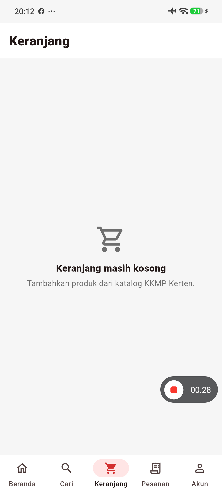
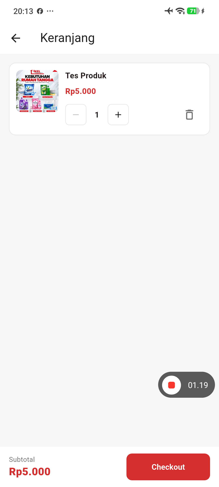
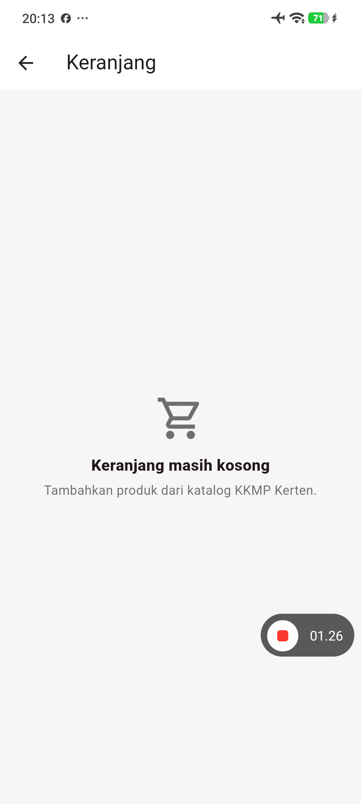

# Laporan UTS Maestro Studio — KKMP Kerten

**Konteks:** UTS Mobile Testing 2026/2027, pengujian customer pada aplikasi Flutter Android KKMP Kerten.  
**Perangkat:** Xiaomi Android fisik, Maestro Studio mode Local (bukan Cloud).  
**App ID:** `com.fauzibondanp.shopmart`  
**Hasil terverifikasi dari screenshot pengguna, 11 November 2026:** **12/12 PASS, 0 FAIL**, durasi **6 menit 52 detik**.  
**Identitas:** [Nama resmi], [NIM], kelas TI23B [verifikasi], [peran] — lengkapi sebelum pengumpulan.  
**Tautan video 5–10 menit:** [belum diisi].

## Metodologi

- Maestro Studio di Mac menjalankan 12 YAML pada HP Xiaomi fisik melalui ADB.
- Setiap flow melakukan assertion pada elemen penting dan memiliki perintah `takeScreenshot`.
- Sesi customer harus login sebelum menjalankan flow akun, cart, pesanan dan bantuan.
- Flow customer tidak menyimpan password baru, tidak mengirim pesan, tidak membuat pesanan final dan tidak menguji Super Admin.
- **12/12 PASS merupakan hasil Maestro Studio, bukan 136/136 PASS UAT dan bukan hasil MCP Server.**

## Matriks pengujian (ringkas)

| ID | Flow | Persona/prasyarat | Langkah dan kriteria penerimaan | Actual | Status | Screenshot asli |
|---|---|---|---|---|---|---|
| ST-01 | [01_startup.yaml](../.maestro/studio-uts/01_startup.yaml) | Guest, APK terpasang | Buka aplikasi, Beranda, tagline dan kategori; elemen tujuan harus terlihat | Elemen yang diperiksa terdeteksi saat run Studio | **PASS** | `uts-01-startup.png` |
| ST-02 | [02_navigasi_pencarian.yaml](../.maestro/studio-uts/02_navigasi_pencarian.yaml) | Guest, APK terpasang | Cari beras dan pastikan hasil tampil; elemen tujuan harus terlihat | Elemen yang diperiksa terdeteksi saat run Studio | **PASS** | `uts-02-navigasi-cari.png` |
| ST-03 | [05_validasi_pencarian.yaml](../.maestro/studio-uts/05_validasi_pencarian.yaml) | Guest, APK terpasang | Cari zzzuatnotfound, verifikasi empty state; elemen tujuan harus terlihat | Elemen yang diperiksa terdeteksi saat run Studio | **PASS** | `uts-05-invalid-search.png` |
| ST-04 | [07_urutkan_harga.yaml](../.maestro/studio-uts/07_urutkan_harga.yaml) | Guest, APK terpasang | Pilih harga terendah, verifikasi pilihan; elemen tujuan harus terlihat | Elemen yang diperiksa terdeteksi saat run Studio | **PASS** | `uts-07-sort-price.png` |
| ST-05 | [06_detail_produk.yaml](../.maestro/studio-uts/06_detail_produk.yaml) | Guest, APK terpasang | Buka detail beras, verifikasi deskripsi produk; elemen tujuan harus terlihat | Elemen yang diperiksa terdeteksi saat run Studio | **PASS** | `studio-uts-06-detail-produk.png` |
| ST-06 | [03_cart_create_read.yaml](../.maestro/studio-uts/03_cart_create_read.yaml) | Customer login, APK terpasang | Tambah beras ke keranjang, buka ulang, cek persistensi; elemen tujuan harus terlihat | Elemen yang diperiksa terdeteksi saat run Studio | **PASS** | `uts-03-cart-persisted.png` |
| ST-07 | [08_wishlist_customer.yaml](../.maestro/studio-uts/08_wishlist_customer.yaml) | Customer login, APK terpasang | Akun → Wishlist dan verifikasi halaman; elemen tujuan harus terlihat | Elemen yang diperiksa terdeteksi saat run Studio | **PASS** | `studio-uts-08-wishlist.png` |
| ST-08 | [09_riwayat_pesanan.yaml](../.maestro/studio-uts/09_riwayat_pesanan.yaml) | Customer login, APK terpasang | Buka Pesanan Saya, verifikasi daftar; elemen tujuan harus terlihat | Elemen yang diperiksa terdeteksi saat run Studio | **PASS** | `studio-uts-09-pesanan.png` |
| ST-09 | [10_notifikasi_customer.yaml](../.maestro/studio-uts/10_notifikasi_customer.yaml) | Customer login, APK terpasang | Akun → Notifikasi, verifikasi Baca semua; elemen tujuan harus terlihat | Elemen yang diperiksa terdeteksi saat run Studio | **PASS** | `studio-uts-10-notifikasi.png` |
| ST-10 | [11_validasi_alamat.yaml](../.maestro/studio-uts/11_validasi_alamat.yaml) | Customer login, APK terpasang | Buka Tambah Alamat, simpan kosong, cek Wajib diisi; elemen tujuan harus terlihat | Elemen yang diperiksa terdeteksi saat run Studio | **PASS** | `studio-uts-11-alamat-kosong.png` |
| ST-11 | [12_keamanan_akun.yaml](../.maestro/studio-uts/12_keamanan_akun.yaml) | Customer login, APK terpasang | Dialog Ganti Password, lalu Batal; elemen tujuan harus terlihat | Elemen yang diperiksa terdeteksi saat run Studio | **PASS** | `studio-uts-12-dialog-password.png` |
| ST-12 | [13_pusat_bantuan.yaml](../.maestro/studio-uts/13_pusat_bantuan.yaml) | Customer login, APK terpasang | Buka Pusat Bantuan, verifikasi kolom Tulis pesan; elemen tujuan harus terlihat | Elemen yang diperiksa terdeteksi saat run Studio | **PASS** | `studio-uts-13-chat.png` |

## Penjelasan empat persyaratan Maestro pada soal UTS

1. **Pembukaan aplikasi:** 01 startup menguji Beranda, tagline dan kategori.
2. **Navigasi:** 02 pencarian, 07 sorting, 08 Wishlist, 09 Pesanan, 10 Notifikasi, dan 13 Bantuan.
3. **Transaksi/CRUD:** 03 menambahkan dan membaca ulang keranjang setelah aplikasi dibuka kembali (**CREATE/READ**). Pengujian tambahan UTS-14 setelah perbaikan aplikasi memperlihatkan **CREATE/READ/UPDATE/DELETE** dengan enam screenshot asli; bukan submit order.
4. **Validasi kesalahan:** 05 produk tidak ditemukan, 11 form alamat kosong menghasilkan `Wajib diisi.`.

## Pengamatan dan batasan

- Layar detail produk menunjukkan deskripsi, tetapi ini tidak membuktikan semua data produk benar terhadap basis data.
- Gambar keranjang menunjukkan beras dan subtotal; assertion YAML membuktikan persistensi cart, bukan pengujian aritmetika lengkap semua harga.
- Validasi alamat kosong PASS **tidak** membuktikan bug MCP UAT-036 (alamat valid tidak tersimpan) selesai.
- Skenario keamanan membuka dialog dan memilih Batal. Tidak ada perubahan password.
- Fitur Pusat Bantuan dibuka tanpa mengirim pesan customer service.
- Tiga error selector pada run awal (detail produk, Ganti password, Pusat Bantuan) telah dikoreksi sebelum hasil 12/12 PASS.

## Bukti dan dokumentasi

Bukti foto asli ada pada Mac penguji di `~/.maestro/tests/2026-11-11_161134/artifacts/takeScreenshot/`. Folder GitHub `uat/evidence/maestro-studio/` disediakan untuk arsip setelah ditinjau. **Saat dokumen ini pertama kali dibuat, gambar belum disalin ke repo**, sehingga jangan mengklaim sudah tersimpan di GitHub tanpa memeriksa foldernya.

Jalankan `bash scripts/push_maestro_studio_evidence.sh` dari proyek Mac untuk menyalin hasil, memeriksa privasi, dan melakukan commit/push setelah persetujuan. Laporan Word/PDF yang sudah dibuat secara terpisah dapat ditambahkan melalui skrip bila tersimpan di Downloads.

## Kesesuaian pengumpulan UTS

Syarat minimal 5 skenario UAT, minimal 4 YAML, assertion, screenshot/log, README, source code, petunjuk perangkat, 5 commit bermakna: **ada cakupan di proyek**. Namun identitas resmi, video 5–10 menit beserta URL, akses dosen ke repo privat, dan larangan API key pada kode sumber harus dituntaskan sebelum pengumpulan.

## Kesimpulan

12 flow Maestro Studio yang berfokus pada pelanggan sudah menunjukkan **PASS 12/12** dalam eksekusi lokal di Xiaomi. Laporan ini dipisahkan dari hasil Maestro MCP Server: 14 PASS, 1 FAIL, 3 BLOCKED, 118 NOT RUN pada matriks 136 kasus UAT. Status UAT MCP tidak boleh digabung dengan status 12 flow Studio.

## Pengujian tambahan UTS-14 — CRUD keranjang lengkap (11 November 2026)

**Flow:** [00_crud_keranjang_lengkap.yaml](../.maestro/studio-uts/00_crud_keranjang_lengkap.yaml)  
**Peran:** Customer (login aktif)  
**Perangkat:** Xiaomi Android fisik, Maestro Studio lokal  
**Produk uji:** Tes Produk, harga Rp5.000/unit  
**Prasyarat:** Aplikasi versi perbaikan terpasang; akun customer aktif; produk uji tersedia, belum ada dalam keranjang  
**Tujuan:** Memastikan operasi CREATE, READ, UPDATE (+ dan −), DELETE dan persistensi penghapusan pada keranjang bekerja dengan benar  
**Pelaksanaan:** Penguji mengonfirmasi telah menjalankan dan merekam alur UTS-14 pada HP fisik. Keenam screenshot asli telah berhasil di-push ke GitHub dan diperiksa pada 11 November 2026.  
**Hasil:** **PASS berdasarkan bukti visual keenam tahap**. Screenshot akhir run Maestro Studio yang menampilkan label PASS belum disertakan, sehingga tidak mengklaim run gabungan 13/13 PASS dalam satu sesi.

### Hasil per langkah

| Langkah | Aksi | Kriteria penerimaan | Hasil aktual (screenshot) | Penilaian visual |
|---|---|---|---|---|
| Kondisi awal | Membuka keranjang sebelum uji | Tes Produk belum ada | Keranjang kosong | PASS |
| CREATE + READ | Cari Tes Produk, tekan Beli Sekarang | Item ditambah; jumlah 1 | Tes Produk tampil; subtotal Rp5.000 | PASS |
| UPDATE (+) | Tekan + | Jumlah 1 → 2 | Jumlah 2; subtotal Rp10.000 | PASS |
| UPDATE (−) | Tekan − | Jumlah 2 → 1 | Jumlah 1; subtotal Rp5.000 | PASS |
| DELETE | Tekan ikon hapus | Produk uji hilang | Keranjang kembali kosong | PASS |
| Persistensi | Buka ulang aplikasi lalu lihat keranjang | Produk yang dihapus tidak kembali | Keranjang tetap kosong | PASS |

### Lampiran screenshot asli — UTS-14

**Gambar CRUD-1. Kondisi awal sebelum CREATE: keranjang masih kosong**

[Sumber PNG asli](evidence/maestro-studio/crud-uts-14/uts-14-cart-before.png)

**Gambar CRUD-2. CREATE/READ: Tes Produk, jumlah 1, subtotal Rp5.000**

[Sumber PNG asli](evidence/maestro-studio/crud-uts-14/uts-14-created.png)

**Gambar CRUD-3. UPDATE (+): jumlah 2, subtotal Rp10.000**

[Sumber PNG asli](evidence/maestro-studio/crud-uts-14/uts-14-updated-plus.png)

**Gambar CRUD-4. UPDATE (-): kembali jumlah 1, subtotal Rp5.000**

[Sumber PNG asli](evidence/maestro-studio/crud-uts-14/uts-14-updated-minus.png)

**Gambar CRUD-5. DELETE: Tes Produk terhapus dan keranjang kosong**

[Sumber PNG asli](evidence/maestro-studio/crud-uts-14/uts-14-deleted.png)

**Gambar CRUD-6. Verifikasi persistensi: setelah aplikasi dibuka ulang keranjang tetap kosong**

[Sumber PNG asli](evidence/maestro-studio/crud-uts-14/uts-14-delete-persisted.png)

**Interpretasi:** Dari keenam screenshot dan urutan eksekusi yang dilaporkan, seluruh tindakan CRUD dan persistensi penghapusan dapat diamati. Foto tidak membuktikan nilai database secara independen dan tidak menggantikan log hasil Maestro. **Hasil lama 12 PASS / 0 FAIL adalah sesi terpisah**; tidak ada kebutuhan merekam ulang 12 flow lama.

## Koreksi bug keranjang setelah hasil Studio 12/12 PASS

Pengguna menguji tombol **+**, **−**, dan hapus secara manual dan melaporkan tidak ada perubahan. Pemeriksaan log Supabase pada 11 November 2026 menunjukkan RPC `set_cart_quantity` beberapa kali sukses **HTTP 204**, tetapi ada juga **HTTP 400** dengan pesan `Cart item not found`. Kode Flutter saat itu tidak menangkap error pada ketiga tombol, sehingga operasi yang gagal tidak memberi umpan balik ke pengguna.

Perubahan pada branch uji: permintaan kuantitas/hapus dijalankan **satu per satu**, indikator proses tampil, hasil dibaca ulang dari server dan dibandingkan dengan kuantitas yang diminta, error ditampilkan dalam SnackBar, dan tersedia tombol retry baca data. Tombol kurang tidak menghapus barang ketika jumlah satu; hapus dilakukan via ikon tempat sampah. Area sentuh tombol +/- diperbesar.

**Pembaruan lapangan:** Setelah APK perbaikan dipasang, penguji menjalankan CRUD terbaru dan menyimpan enam screenshot di GitHub. Bukti visual mendukung keberhasilan CREATE, READ, UPDATE (+/−), DELETE serta persistensi penghapusan. Bukti layar ringkasan PASS Maestro untuk UTS-14 belum dilampirkan.
